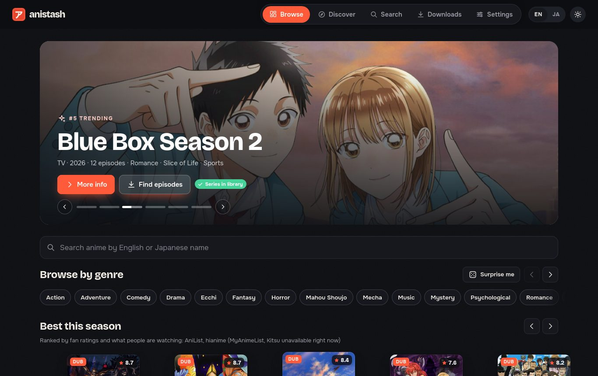
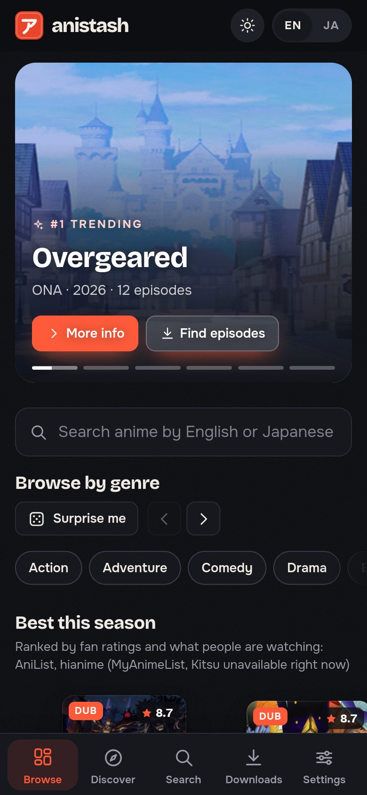
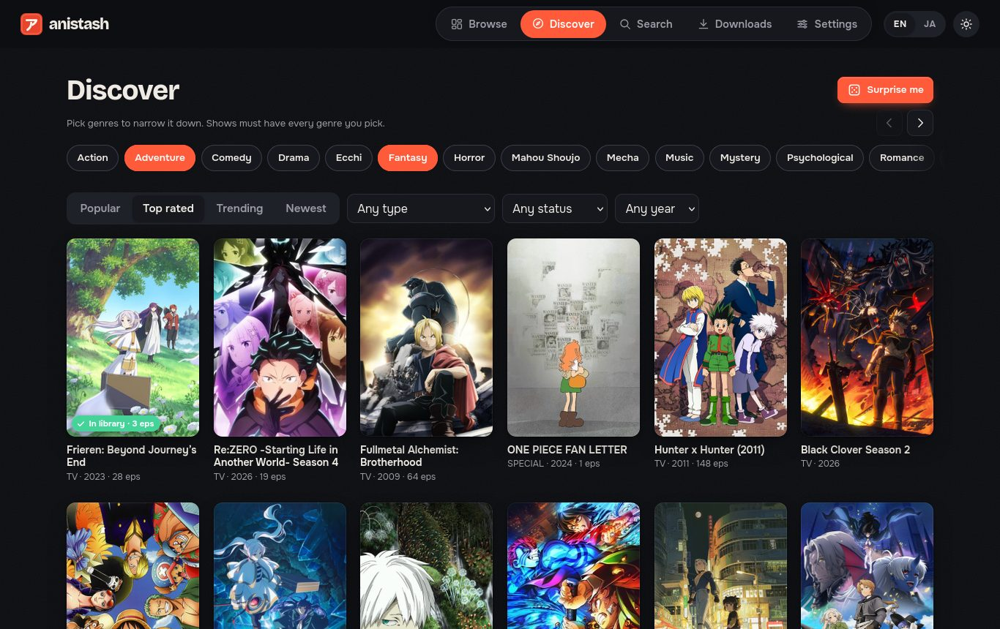
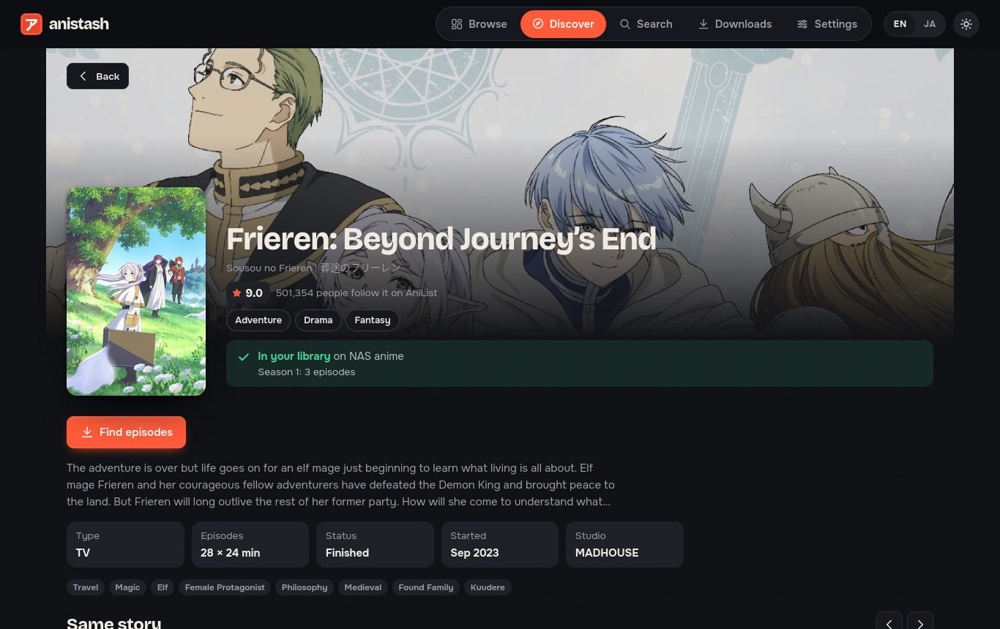
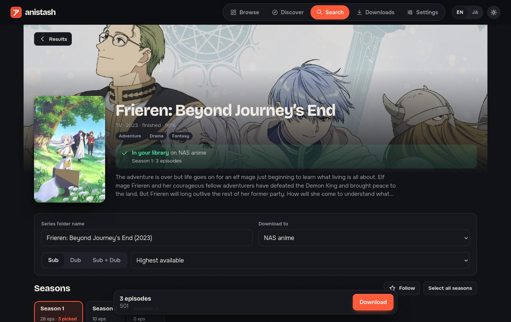
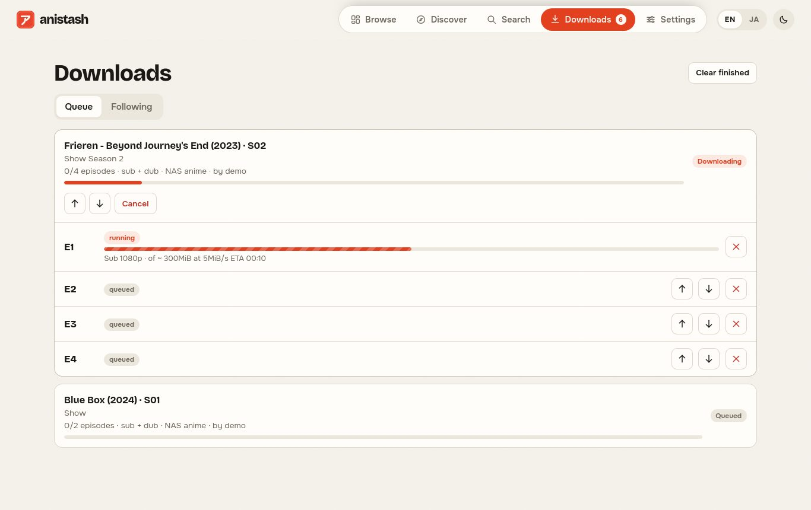
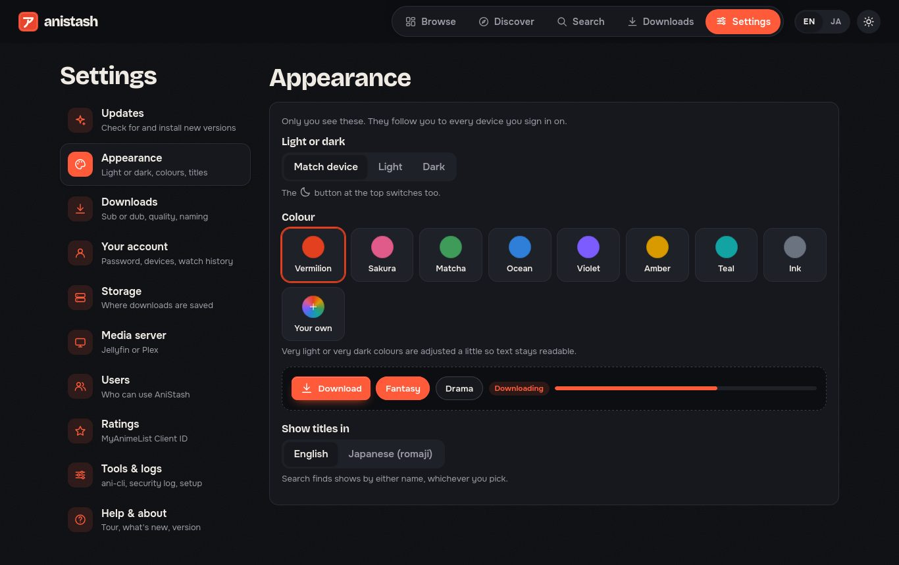
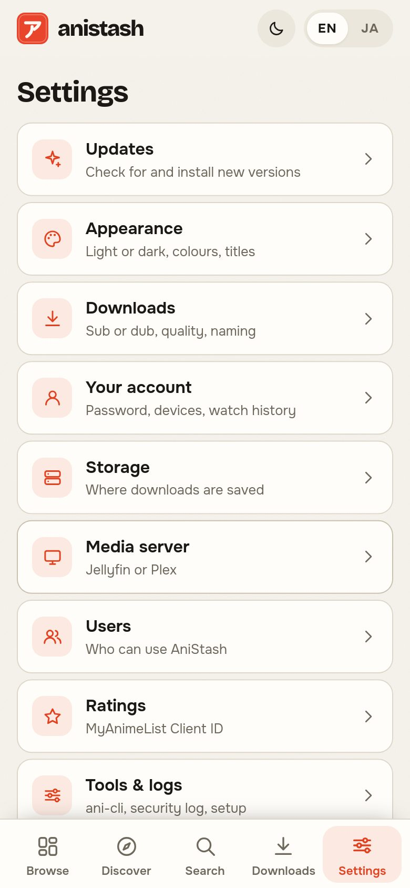

# AniStash

[](https://github.com/JustinMarxGit/anistash/actions/workflows/tests.yml)
[](https://github.com/JustinMarxGit/anistash/releases)
[](LICENSE)

**A self-hosted companion for Jellyfin and Plex that grows your anime library.** Browse and discover anime in a
friendly web app, pick whole series, seasons or single episodes, and AniStash downloads them (through
[ani-cli](https://github.com/pystardust/ani-cli)) straight to your NAS: named, checked and organised the way
Jellyfin and Plex expect, with only your anime library rescanned afterwards. Follow a show and new episodes arrive
by themselves.

It runs in its own Proxmox LXC, created with one command, and works on phones as well as desktops.

> **Made with AI:** AniStash was written with [Claude Code](https://claude.com/claude-code), Anthropic's AI coding
> assistant, directed, reviewed and tested by its maintainer. See [How AniStash was made](#how-anistash-was-made).

<p align="center">
  
  
</p>

| Discover by genre | An anime's page | Picking episodes |
| --- | --- | --- |
|  |  |  |

| Downloads | Settings: your own colours | Settings on a phone |
| --- | --- | --- |
|  |  |  |

**Contents:** [Features](#features) · [Requirements](#requirements) · [Install](#install) · [Setup](#setup) ·
[Discover](#discover) · [Recommendations](#recommendations) · [Following shows](#following-shows) ·
[Users and security](#users-and-security) · [Updates](#updates) · [Backup, restore and uninstall](#backup-restore-and-uninstall) ·
[FAQ](#faq) · [Troubleshooting](#troubleshooting) · [How AniStash was made](#how-anistash-was-made) ·
[Disclaimer](#disclaimer) · [License](#license)

## Features

- **Browse like a streaming app:** a rotating spotlight of what's trending, *Best this season*, *Picked for you*,
  trending and seasonal rows, and genre shortcuts. On phones you can flick the spotlight away with your thumb.
- **Discover:** every anime by genre (combine several), sorted by popular, top rated, trending or newest, filtered
  by type, status and year. **Surprise me** opens a random, well-liked show.
- **Anime pages:** synopsis, score, studio, genres, *Same story* (prequels, sequels) and *More like this*.
- **Recommendations:** *Best this season* combines **MyAnimeList, AniList and Kitsu** ratings with what's popular on
  the anime site. *Picked for you* learns from what each person **watches in Jellyfin or Plex** and has in the
  library, and says why ("Because you watched Frieren").
- **Search by English or Japanese name**, with an EN / JA switch for every title.
- **Seasons done right:** a show's seasons are grouped automatically (including "Season 3 Part 2" and "Final
  Season"). Queue every season at once, one season, or specific episodes (`1-5, 8, 12-`).
- **Sub, dub, or both:** **Sub + Dub** gives one file with Japanese and English audio, switchable in your player.
- **Highest quality with fallback:** the best quality offered, stepping down if a download fails or comes out broken.
- **Files your media server plays directly:** checked with ffprobe, remuxed (no re-encode) to MP4 with subtitles as
  `.en.srt`, in `Show (2013)/Season 01/Show (2013) - S01E01.mp4`.
- **Library-aware:** *✓ In library* badges from your download folders and your Jellyfin/Plex library.
- **Scans only what's new:** Jellyfin/Plex is asked to scan just the new folders, or at most your anime library.
  Never a full scan.
- **Follow shows:** new episodes (and new seasons) download by themselves, timed around each broadcast.
- **Download locations:** SMB or NFS shares, or local folders, added and tested from the web UI.
- **Multi-user:** admin, member and viewer roles, with careful security (see below).
- **Updates from the web page:** one click (or automatically), with live progress and automatic rollback.
- **Your look:** a light/dark switch at the top, and under Settings → Appearance a choice of colour schemes or any
  colour you like. Each person's choice is their own and follows them to every device.
- **Settings that are easy to find:** grouped into sections (Updates, Appearance, Downloads, Storage, Media server,
  Users…), a sidebar on desktop and a simple list on phones.
- **Explains itself:** every button has a plain-language tooltip, and new users get a short guided tour.

## Requirements

- **Proxmox VE** (8 or newer) on an **amd64** host, with internet access. The script creates a Debian LXC
  (2 cores, 1 GB RAM and 8 GB disk by default; downloads go to your NAS, not the container).
- **Somewhere to keep the anime:** an SMB or NFS share on your NAS, or a folder in the container.
- **Optional:** Jellyfin or Plex, for library scans, *✓ In library* badges and watch-history recommendations.

Not on Proxmox? The installer also works inside any Debian 12/13 machine or container (see below).

## Install

On the Proxmox VE host's shell, as root:

```bash
bash -c "$(curl -fsSL https://raw.githubusercontent.com/JustinMarxGit/anistash/main/ct/anistash.sh)"
```

- **Default settings**: Debian, 2 cores, 1 GB RAM, 8 GB disk, DHCP on `vmbr0`. No questions asked.
- **Advanced settings**: container ID, hostname, password, Debian version, disk, CPU, RAM, storage, bridge, **static IPv4 + gateway**, IPv6, DNS, MAC, VLAN, MTU, SSH, tags (or none), web UI port and timezone. A summary screen shows everything before the container is created.

Every option can also be preset as an environment variable to skip its question. For example:

```bash
MODE=advanced CTID=120 NET=192.168.1.50/24 GATE=192.168.1.1 VLAN=20 \
  bash -c "$(curl -fsSL https://raw.githubusercontent.com/JustinMarxGit/anistash/main/ct/anistash.sh)"
```

Variables: `MODE CTID HN PW OS_VERSION DISK CORES RAM STORAGE TEMPLATE_STORAGE BRG NET GATE IPV6 GATE6 DNS SD MAC VLAN MTU SSH SSH_KEY TAGS PORT TZ VERBOSE`. With `MODE` set, the script runs without any dialogs. `TAGS=` (empty) creates the container without any tags.

> The container is **privileged**, because an unprivileged LXC can't mount SMB/NFS shares itself. If you'd rather keep it unprivileged, mount the share on the Proxmox host, bind-mount it into the container, and add it in AniStash as a *local folder*.

Already have a Debian 12+ container? Run the installer inside it instead:

```bash
curl -fsSL https://raw.githubusercontent.com/JustinMarxGit/anistash/main/install/install.sh | bash
```

## Setup

The installer only sets up the container. Open `http://<container-ip>:8000` and the setup wizard walks you through:

1. A system check (ani-cli, yt-dlp, ffmpeg and a test search)
2. The admin account
3. Download locations: your NAS share (SMB or NFS) or a local folder, each mounted and tested
4. Jellyfin or Plex (optional): URL, API key or token, and the **anime library** to scan
5. Download defaults: sub/dub, maximum quality, downloads at once, naming

You can rerun it later from Settings → Tools & logs → *Run setup again*. For the same steps in a terminal, run `anistash-setup` in the container's console.

### Jellyfin and Plex scans

AniStash never asks your media server to scan everything:

| Location has a "media server sees this as" path | AniStash scans |
| --- | --- |
| yes | only the new season folders (fastest) |
| no | only the anime library you picked |
| no library picked | nothing (the download shows a warning) |

The path is the same folder as Jellyfin or Plex sees it. For example, your NAS share `media/anime` is mounted in Jellyfin's container at `/media/anime`. The library dropdown shows each library's folders to help you fill it in.

- **Jellyfin API key:** Dashboard → API Keys → +
- **Plex token:** in Plex Web, open any item → ⋯ → Get Info → View XML, and copy the `X-Plex-Token` value from the address bar.

## Discover

- **Discover tab:** browse every anime on AniList by genre. Pick several genres to combine them; a show must have all of them.
  - **Sort:** popular, top rated, trending or newest.
  - **Filter:** type (TV, movies, ONA/OVA), status (airing, finished, coming soon) and year.
  - It keeps loading as you scroll, and the filters stay in the address, so Back and shared links work.
- **Surprise me** (Browse and Discover) opens a random anime that at least a few thousand people follow, so it's worth a look. On Discover it keeps to your genres. *Another surprise* rolls again.
- **Anime pages:** every poster opens the anime's own page. It shows the synopsis, score, genres (tap one to browse it), studio and episodes, then *Same story* (prequels, sequels, side stories) and *More like this*, AniList fans' recommendations. *Find episodes* searches the anime site to download it.
- **Show pages** (where you pick episodes) also suggest *More like this*.

## Recommendations

Browse opens with two lists of shows that are airing now.

- **Best this season** combines fan ratings from **MyAnimeList**, **AniList** and **Kitsu**, plus what people are watching on **hianime**, the site ani-cli downloads from.
  - **How the rating works:** each site's score is first pulled toward an average according to how many people rated the show, so a few dozen perfect scores can't beat a show thousands love. The sites are then weighted MAL 45%, AniList 40%, Kitsu 15%.
  - **Ranking:** popularity on hianime (Trending, Top Airing, most watched today) and AniList's trending break ties.
  - **Each poster** shows the combined rating; hover over it to see each site's score. A **Dub** tag means an English dub is out.
- **Picked for you** looks at what *you* follow and queued, and what's in the library.
  - It uses AniList's fan recommendations both ways: "fans of a show you have like this" and "fans of this like a show you have". Shared genres also count, and weak or decades-old shows are filtered out.
  - Each pick says why: *Because you have Blue Box*, or *New season of Frieren* for a show you have only earlier seasons of.
  - Shows you already have or follow are left out.
  - **It learns from what you watch** in Jellyfin or Plex. Each AniStash user is linked to their own media server account, matched by username automatically; change it under *Settings → Your account*, or for anyone under *Settings → Users*. Shows you watched a lot, recently, or marked as favorites count most. Shows you tried and dropped, or that only sit in the library, count little. Picks then say *Because you watched …*. Choose *Don't use watch history* to opt out.

Every site is optional. If one is down, the others still rank the shows, and the page says which one is missing. Scores are cached for 6 hours and hianime's lists for 1 hour, and the ranking is rebuilt in the background, so Browse doesn't wait for the sites.

**MyAnimeList Client ID (optional, admins):** MAL's official API needs a free Client ID. Create one at myanimelist.net → *Account settings → API → Create ID* (App type: *other*) and paste it under **Settings → Ratings**. It's stored encrypted. Without one, AniStash uses Jikan, a public MAL mirror, whenever it's reachable.

## Following shows

On a show page, **☆ Follow** keeps that show up to date:

- **Follow options:** pick the season to follow (the newest by default), whether to also follow new seasons, and what to do with episodes already out: download what's missing from every season, from just that season, or skip them and only get new ones.
- **Timing:** AniStash reads the airing schedule from AniList and checks about 20 minutes after each broadcast. Until the episode shows up on the site it checks every hour, because uploads trail the broadcast by a few hours and dubs by longer. Finished shows are still checked (every few hours, then daily, then weekly) for late dubs and new seasons.
- **What gets downloaded:** new episodes go through the normal queue, with the same quality fallback, naming and Jellyfin/Plex scan, tagged *auto*. Episodes already on disk are skipped. Failed ones are retried on later checks. Episodes you cancel are left alone.
- **Managing follows:** use **Downloads → Following** to see the next episode and when it airs, the last check, and to Check now, Pause, or Unfollow. Members can follow shows; viewers can't.

## Users and security

Settings → **Users** (admins only) is where you add accounts and give each person a role:

| Role | Can |
| --- | --- |
| **Admin** | everything: users, download locations, media server, settings, updates |
| **Member** | browse, search and download; cancel/retry/reorder **their own** downloads |
| **Viewer** | browse and search only |

New users get a temporary password (there's a *Generate* button) and must choose their own at first login. Admins can reset passwords, change roles, disable or delete accounts. There is always at least one active admin.

How it's protected:

- **Passwords** are hashed with scrypt (N=2^16, r=8, p=2, per-user salt), following OWASP's password storage guidance; they're never stored or logged in plain text. Passwords need 10+ characters and can't be common ones.
- **Sessions** use a random 256-bit token in an `HttpOnly`, `SameSite=Strict` cookie. Only a SHA-256 of it is stored. Sessions expire after 7 idle days / 30 days at most and end on logout, password change, role change or when an account is disabled. *Log out on all devices* is under Settings → Your account.
- **Brute force**: 5 failed logins lock that username, 20 lock that IP address, each for 15 minutes. Wrong usernames and wrong passwords get the same answer in the same time.
- **Cross-site requests** are rejected (custom request header + origin check), and every page sends a strict Content-Security-Policy, `X-Frame-Options: DENY`, `nosniff` and `no-referrer`.
- **Access control** is enforced by the server on every request, not just hidden in the UI.
- **Secrets at rest**: the Jellyfin/Plex token is encrypted (Fernet: AES + HMAC) with a key in `/etc/anistash/secret.key` that only the service can read. NAS passwords live in root-only (`0600`) credential files, never in the database, because the kernel's SMB mount needs to read them. The database itself is readable only by the service.
- **Security log**: logins, failed attempts, lockouts and changes to users and settings, under Settings → Tools & logs.

Locked out? In the container console, run `anistash-setup --reset-password`. It sets a new password and lifts the lockout.

For access from outside your home network, put AniStash behind a reverse proxy with HTTPS (the session cookie is marked `Secure` automatically when it sees HTTPS).

## Updates

- **Automatic** (Settings → Updates, the setup wizard, or `anistash-setup`): AniStash checks GitHub for a new release every 30 minutes. It installs it only while nothing is downloading. If the new version doesn't start, the previous one is put back, and that version isn't retried for 12 hours.
- **From the web UI**: admins get *Update now* in the banner that appears when a new version is out, and **Settings → Updates** (first in the list), whose *Check for updates* asks GitHub straight away instead of waiting for the next check.
  - Either button runs `anistash-update` and shows each step as it happens: download, install, restart.
  - When the new version is up, the page reloads by itself.
  - If the update fails, the window says why; the previous version has already been put back.
- **Every open page follows along**: other tabs, phones and other people's sessions notice the new version on their next refresh and reload too. This includes automatic updates. A page waits if you're halfway through filling in a window.
- **In the container**: run `anistash-update`.
- Only **admins** can see or start updates; the server refuses anyone else.
- Each person sees a short **What's new** the first time they open AniStash after an update.

## Backup, restore and uninstall

- **What to back up:** `/var/lib/anistash` (database: users, settings, queue, follows) and `/etc/anistash`
  (encryption key and SMB credentials). Your downloaded anime lives on your NAS and isn't touched by AniStash
  except to add new files. A Proxmox backup of the container (`vzdump`) covers everything.
- **Restore:** install AniStash, stop it (`systemctl stop anistash`), copy both folders back, then
  `systemctl start anistash`.
- **Uninstall:** on the Proxmox host, `pct stop <id> && pct destroy <id>`. Files already downloaded to your NAS
  stay where they are.

## FAQ

- **Why is the container privileged?** An unprivileged LXC can't mount SMB/NFS shares itself. Prefer
  unprivileged? Mount the share on the Proxmox host, bind-mount it into the container, and add it in AniStash as a
  *local folder*. Everything else works the same.
- **Where do the videos come from?** AniStash doesn't host or stream anything. It runs
  [ani-cli](https://github.com/pystardust/ani-cli), which fetches episodes from a third-party anime site. See the
  [Disclaimer](#disclaimer).
- **Do I need a MyAnimeList account?** No. MAL scores come from Jikan (a public mirror) when it's up. For reliable
  MAL scores, add a free MAL Client ID under Settings → Ratings.
- **Can my family use it?** Yes. Add them under Settings → Users as *member* (can download) or *viewer* (browse
  only). Each person gets their own *Picked for you* from their own Jellyfin/Plex watching.
- **Can I reach it from outside my home?** Use a VPN (WireGuard, Tailscale) or a reverse proxy with HTTPS and
  authentication in front of it. Don't expose it to the internet directly.

## Console commands (inside the LXC)

| Command | What it does |
| --- | --- |
| `anistash-setup` | Setup menu: account, locations, media server, defaults |
| `anistash-setup --reset-password` | New password for any user; also unlocks the account |
| `anistash-setup --reset` | Forget all configuration (downloads stay) |
| `anistash-update` | Update to the newest GitHub release (rolls back on failure) |
| `anistash-update --check` | Only check for an update |
| `anistash-update --version v0.1.0` | Install a specific release |
| `anistash-update --branch main` | Follow the development branch |
| `journalctl -u anistash -f` | Live logs |

Settings, locations and the queue survive updates. The web UI port is set in `/etc/anistash/anistash.env`.

## Troubleshooting

- **Searches fail or return nothing**: the anime site probably changed. Click Settings → Tools & logs → *Update ani-cli and yt-dlp*. This also runs weekly on its own.
- **A location shows "Not mounted"**: click *Test*, which remounts it and shows the error from the NAS. Check that the share allows the user you entered to write.
- **A download shows "scan failed"**: the file is downloaded fine; only the Jellyfin/Plex notification failed. Check the URL, key or token and the chosen library under Settings → Media server.
- **A Sub + Dub episode only has Japanese audio**: when the dub can't be added (not uploaded yet, a different length, or the site serving the Japanese audio again), the episode is still saved with Japanese audio, and the queue says why.
- **A dub download has Japanese audio**: AniStash asks ani-cli for the dub correctly (`--dub`), but with ani-cli 5.1.5 its current anime site sometimes hands back the sub stream for dubs. Run *Update ani-cli and yt-dlp* under Settings → Tools & logs; once ani-cli fixes it upstream, dubs come through without any change in AniStash.

## Development

```bash
python3 -m venv .venv && .venv/bin/pip install -r requirements-dev.txt
ANISTASH_DATA_DIR=./data .venv/bin/uvicorn app.main:app --reload
.venv/bin/python -m pytest
```

Locally, only *local folder* locations work, since SMB/NFS needs the root helper installed in the LXC. Tests use a fake `ani-cli` (`tests/fake_ani_cli.sh`) and need `ffmpeg`.

### How it talks to ani-cli

AniStash doesn't scrape anything itself; it drives the installed `ani-cli`:

- **Search results and episode lists:** ani-cli's menu program (`ANI_CLI_MENU`) is pointed at `app/menu_capture.sh`, which records the options and picks nothing.
- **Qualities:** read from ani-cli's `debug` player output.
- **Downloads:** the normal `-d -S -e -q` flags.

When the site changes, `ani-cli -U` fixes AniStash too.

### Speed

Nearly all of a page's wait is the anime site and AniList answering, so AniStash avoids waiting on them in turn:

- **Parallel lookups:** a show page starts each lookup as soon as its input is known. Searches that don't need AniList start straight away, and a season's episode list starts the moment a search finds it.
- **Caching:** ani-cli answers are kept for 10 minutes, in memory and in SQLite, so they survive restarts. Identical lookups made at the same moment run once. At most 4 ani-cli lookups run at a time.
- **AniList:** a season chain is fetched three relations deep per call, over one kept-alive connection.
- **Downloads page:** polls with the queue's revision and gets a 60-byte "unchanged" answer when nothing moved, then patches rows in place.
- **Polling pauses** while the tab is hidden.
- **Static files** are gzipped. `app.js` and `app.css` are versioned, so browsers keep them until the next update.
- **SQLite:** one connection per thread, WAL with `synchronous=NORMAL`, and indexes on the queue tables.

### Layout

```
ct/anistash.sh          Proxmox host script (creates the LXC)
install/                in-container installer, deploy step, anistash-setup, anistash-update, systemd units
helper/anistash-helper  root helper (mounts, tool updates); the only thing the app may sudo
app/                    FastAPI backend (Python) and the frontend (plain JavaScript, no build step)
tests/                  pytest suite (run by GitHub Actions on every push)
docs/screenshots/       the pictures in this README
```

Contributions are welcome: open an issue first for anything big. Run the tests before a pull request.

## How AniStash was made

AniStash was built with generative AI. Its code, tests and documentation were written with
**[Claude Code](https://claude.com/claude-code)**, Anthropic's AI coding assistant, working from the maintainer's
requests and feedback over many iterations. The maintainer decided what to build, reviewed the results, ran it on a
real Proxmox, NAS and Jellyfin setup, and reported what needed fixing.

What that means for you:

- **It's tested, not just generated:** over 170 automated tests run on every change (GitHub Actions), and each
  feature was also checked in a real browser on desktop and phone sizes.
- **Read it like any homelab project:** it's open source, so you can see exactly what it does before you run it,
  especially the parts that run as root (`helper/anistash-helper`, the install scripts).
- **Found a problem?** Please open an issue, or report security issues privately (see [SECURITY.md](SECURITY.md)).

## Disclaimer

AniStash is a front end for [ani-cli](https://github.com/pystardust/ani-cli). It doesn't host, store or distribute
any video, and it isn't affiliated with ani-cli, the sites ani-cli uses, AniList, MyAnimeList, Kitsu, Jellyfin or
Plex. **You are responsible for what you download and for following the copyright laws where you live.** Where
possible, support the creators by watching anime through official, licensed services.

## License

AniStash is free and open source software under the **[GNU General Public License v3.0](LICENSE)**. You may use,
study, share and change it, for free; versions you share must stay under the same license. The bundled fonts
(Bricolage Grotesque, Onest) are under the SIL Open Font License (see `app/static/fonts/`).
